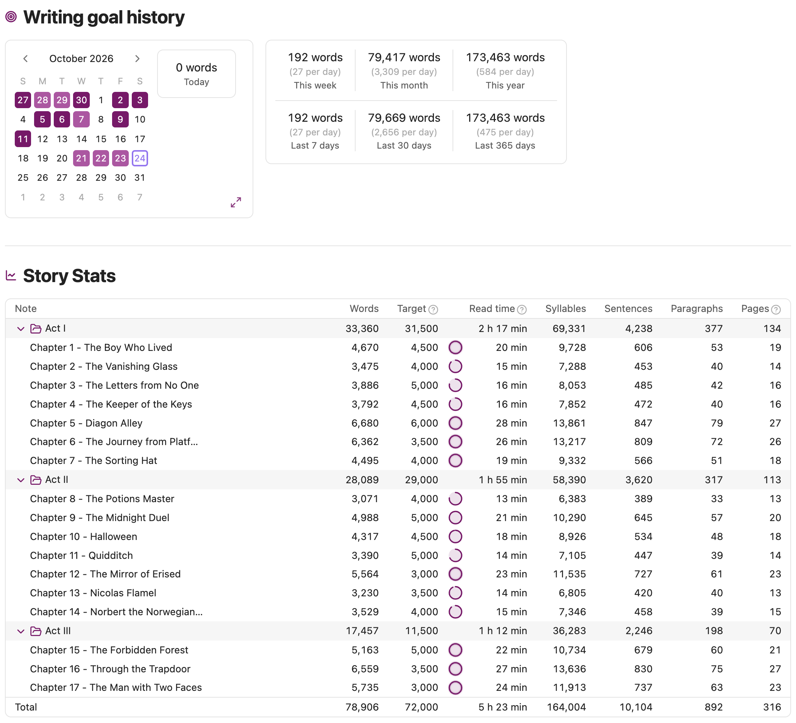
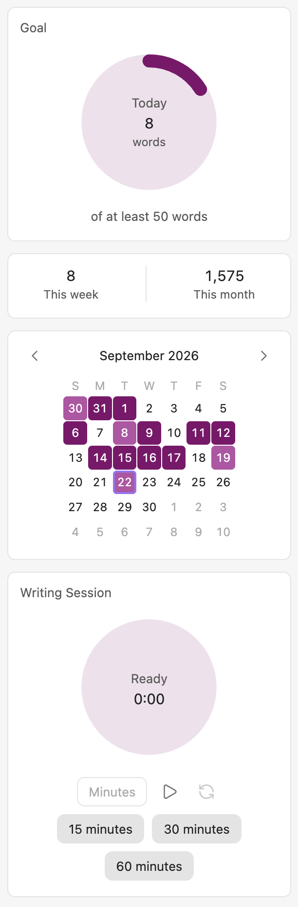
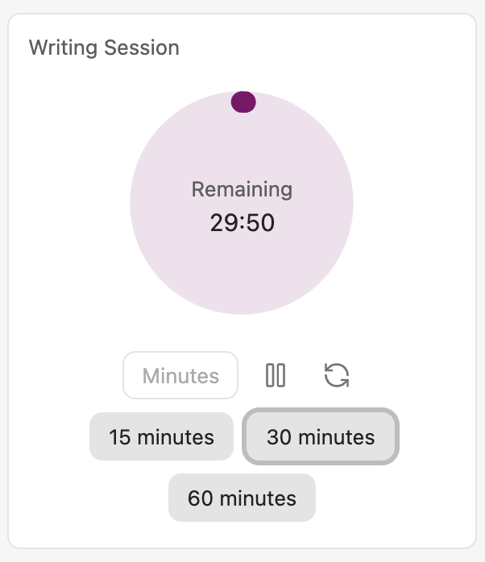
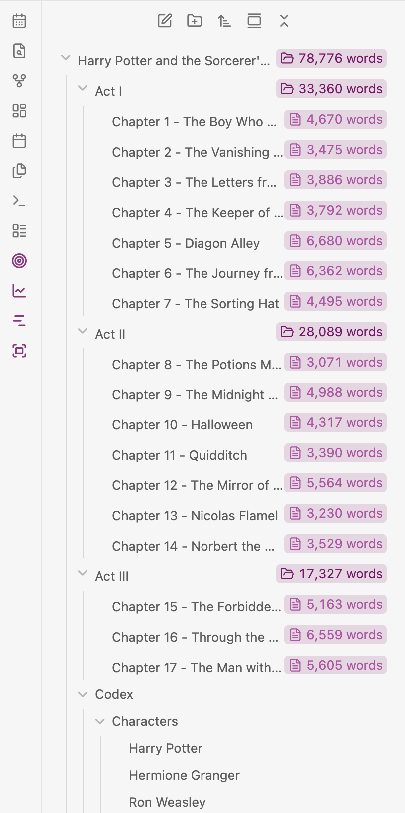

# Scribe of Lagash - Goals and Stats


An [Obsidian](https://obsidian.md) plugin that helps writers set **goals** and see **detailed statistics** for those goals and for the story as a
whole. It is part of the **Scribe of Lagash**
series, a set of independent, focused tools for planning and writing stories
in Obsidian.



## Thank you

If this plugin helps your writing, you can support its development
[buying me a coffee on Ko-fi](https://ko-fi.com/O3J528W3FZ)

<div align="left">

[](https://ko-fi.com/O3J528W3FZ)

## Installation

Requires Obsidian ≥1.10.0.

You can install it from the
[community plugins page](https://community.obsidian.md/plugins/scribe-of-lagash-goals-stats),
or download `main.js`, `manifest.json`, and `styles.css` from the
[latest release](https://github.com/aescanes/scribe-of-lagash-goals-stats/releases/latest)
and copy them into `<vault>/.obsidian/plugins/scribe-of-lagash-goals-stats/`.

## Scribe of Lagash Plugins

**Scribe of Lagash** is a series of independent, single-concern Obsidian
plugins for planning and writing stories:

- **[Scribe of Lagash - Visualization](https://community.obsidian.md/plugins/scribe-of-lagash-visualization)** ([github repository](https://github.com/aescanes/scribe-of-lagash-visualization)) —
  helps writers visualize their chapters and scenes.
- **[Scribe of Lagash - Goals and Stats](https://community.obsidian.md/plugins/scribe-of-lagash-goals-stats)** ([github repository](https://github.com/aescanes/scribe-of-lagash-goals-stats)) —
  helps writers set goals and see detailed statistics for their story.
- **[Scribe of Lagash - Focus](https://community.obsidian.md/plugins/scribe-of-lagash-focus)** ([github repository](https://github.com/aescanes/scribe-of-lagash-focus)) —
  helps writers focus on their work and remove distractions.

Each plugin works fine on its own, and none requires another, but they are
designed to complement each other and work best together.

### About the name

"Scribe" is the writer at the center of every plugin in the series, and
"Lagash" nods to _Nippur de Lagash_, the classic Argentine comic.

## Features

### Writing-goal widget

A right-sidebar view (ribbon icon or the "Open
writing goal widget" command) with a ring for today's progress toward the
daily goal, a week/month summary, and a month calendar coloring each day by
whether it met, partly met, or missed the goal. History is kept in a
plugin-managed file in the vault, so it survives a plugin uninstall/reinstall
and travels with the vault through whatever the author already syncs it
with.



### Goals and Stats tab

A main-area tab (ribbon icon or the "Open goals and stats" command) with a "Writing goal history" section: week/month, rolling
7-/30-day, and year/365-day totals with daily averages, beside the same
month calendar as the sidebar widget with today's total and, when clicked,
any other day's total shown next to it. The expand button in the calendar
card's bottom-right corner switches it to the whole year (all twelve months,
with year prev/next); click it again to return to the month.

#### Story stats

Below the goal history, the tab's "Story Stats" section is a table of every
note in the story folder, grouped by folder (click a folder to collapse it;
each folder shows its own subtotal, and a Total row closes the table). For
each note: words (or characters, following your metric setting), read time,
syllables, sentences, paragraphs, pages and status. Status is the note's
Status column of the Visualization plugin's Outline file (the row whose Act,
Chapter and Scene numbers match the note's folders and file name — digits or
roman numerals, any title language) or, when the outline has none for it, its
`scribe-note-status` property. As in the Visualization plugin, the outline wins. Click a note's name to open it.


### Note stats popup

While a note in the story is open, a stats icon appears in the note's header,
next to its other buttons. Click it, or run "Show note stats", to open a popup with the same
numbers for just that note: its status, the headline word count, read time,
pages, sentences, paragraphs and syllables, and words per sentence, sentences
per paragraph and syllables per word. It updates as you type and follows the
light and dark themes.

Syllable and sentence counts are estimates. Read time is based on 245 words
per minute and pages on 250 words per page; a (?) icon beside each label says
so.

### Daily-goal celebration

The moment you reach the daily goal, a toast
notification plus a confetti burst say so, and a status-bar item lights up
for as long as it stays met, whether or not the writing-goal widget is open.

### Writing session

A plain countdown timer in the writing-goal widget,
unrelated to the daily goal or any particular day: 15/30/60-minute presets
or a custom length, with the same ring styling as the daily-goal progress
ring, play/pause, reset, and a toast plus a short bell sound once time's
up. A session in progress survives closing Obsidian — reopening shows it
paused, ready to resume with a click.



### File-explorer counts

Every note inside the story folder shows its word
(or character) count next to its name in the file explorer, and every folder
shows the total of the notes beneath it. Counts update as you write. Set a
story folder in settings to count only that folder instead of the whole
vault, and add specific notes or folders to the exclusion list to leave them
out of the count entirely. Character counts default to "characters without
spaces", so they'll read lower than Obsidian's own word-count status bar,
which counts every character including spaces and line breaks — turn on
"Count spaces in character counts" in settings to match that convention
instead.



### Writing-goal settings

A story folder (with folder autocomplete;
switching it away from a different folder you've already used asks you to
confirm first, since it starts today's writing count over for the new one
— the previous folder's history is kept, ready to pick back up later), a
words/characters metric (with a with/without-spaces toggle for characters),
and a daily goal. Plus a list of notes and folders to
exclude from everything the plugin measures.

### Files starting with "(SL)"

Your writing history is kept in `(SL) Goals History.json`, a file this plugin
creates for itself in the story folder. Any file or folder whose name starts
with `(SL)` is left out of the counts: it gets no file-explorer count and adds
nothing to your daily total, even inside the story folder. So don't start the
name of a note you want counted with `(SL)`.

## How "written today" is counted

Today's count isn't just "how much longer is the note now" — it's genuinely
new writing, worked out by comparing what each note says right now to what it
said at the start of the day and counting only the words that weren't there
before. That has one nice effect: cleaning up old work doesn't punish you.

- **Deleting something you wrote on an earlier day never lowers today's
  count.** Cut a whole tired paragraph from last week, reorganize a chapter,
  trim an old scene down to nothing — none of it counts against you, because
  none of it was written today.
- **Deleting something you wrote _today_ does lower today's count**, same as
  any ordinary word counter. Write a new sentence, then cut a couple of words
  from it before you're done for the day, and the count reflects what's
  actually on the page.

So the number always answers "how many new words are sitting in my story
right now," not "how many keys did I press today" — a big cleanup of old
material can never accidentally erase a day's progress.

## Planned next

- **Goal targets** — total word/character count, per note and per story.
- **Goal stats** — writing streaks and how each day compares to the target pace.
- **More story stats** — average scene and chapter length, and status read from
  an outline file's Status column.
- **Repeated-word analysis** — most-frequent words and phrases across the
  whole story or a single chapter, with common stop-words filtered out, to
  surface overused crutch words.

See [`docs/feature-plans/`](docs/feature-plans/) for the detailed plan of each
feature (one file per feature).

## Development

```bash
npm install
npm run prepare  # activate the Husky pre-commit hook (once; npm install skips it because ignore-scripts=true)
npm run dev    # watch build, outputs main.js
npm run build  # type-check + production build
npm test       # unit tests (Node's built-in runner; no test framework dependency)
npm run validate # typecheck + test + lint + lint:css (run before every commit)
```

### Supply-chain safety

- Every dependency in `package.json` is pinned to an exact version — no `^`/`~`
  ranges and no `latest`. `.npmrc` sets `save-exact=true` so future
  `npm install <pkg>` additions stay pinned by default.
- `.npmrc` also sets `ignore-scripts=true`, so `npm install`/`npm ci` never
  runs a dependency's `preinstall`/`install`/`postinstall` script
  automatically. The only dependency that ships one is `esbuild`, and its
  script just optimizes linking its already-installed platform binary — the
  build works fine without it. On the rare platform where it doesn't (e.g. an
  environment without a matching prebuilt `@esbuild/*` package), run
  `npm run rebuild:esbuild` to explicitly and visibly opt that one script back
  in for that single command.

To try the plugin in a vault, copy (or symlink) `manifest.json`, `main.js`,
and `styles.css` into `<vault>/.obsidian/plugins/scribe-of-lagash-goals-stats/`,
then enable it from Obsidian's Community Plugins settings.

## Contributing

Found a bug, or have a feature request? Open one on the
[GitHub Issues page](https://github.com/aescanes/scribe-of-lagash-goals-stats/issues) —
there's a template for each.

Contributions are welcome — see [CONTRIBUTING.md](CONTRIBUTING.md) for dev setup, code conventions, and the PR
process. This project follows a [Code of Conduct](CODE_OF_CONDUCT.md).

Found a security issue? See [SECURITY.md](SECURITY.md) instead of opening a public
issue.

See [CHANGELOG.md](CHANGELOG.md) for release history.

## License

[MIT](LICENSE).
